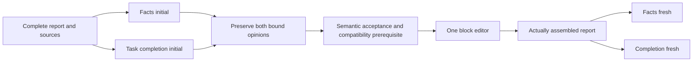

# ADR0117: Complementary review duties and actual edit consumption

2026-10-14. Proposed, offline prototype only. No product adoption or paid
execution authorization. Stage 8E and the existing acceptance standard remain.

## Problem and evidence

The five closed full/facts observations support testing complementary duties:
three facts opinions were accepted by both real reviewers, while duty-3-full
retains a genuine correction-scope disagreement. The first group lacks a same-run
full arm and the second group passed in both arms. These familiar sources do not
establish improvement, stability, or an internal model cause. See
[the closed result](../plans/2026-10-14-review-duty-followup-result.md).

A deterministic counterexample identifies a separate software contract mismatch.
The complete validator rejects a pass with `native_missing_knowledge_citation_unreported`
when knowledge exists but the report has no citation. Facts-only review explicitly
excludes citation presence/consumption obligations. Reusing that complete validator
would therefore reject a legal local opinion. The three observed facts samples did
not exercise this boundary; their original results are not changed.

## Proposed decision and flow

Keep the existing full-review runtime intact. Build an isolated, unregistered
composition in `scripts/review_duty_composition.py`, with no sender or live CLI:

Facts preserves the previously exercised policy. Completion is a new, unmeasured
policy for actual user requirements and existing knowledge/OP.GG consumption
obligations. Its own explanations and corrections must remain factual. Both receive
the same complete report and sources; neither receives the other's opinion during
review. Local pass is never a product pass.

The scoped validator checks strict wire shape, source/block references, security,
and fresh-review semantics without swallowing errors from the old full validator.
Facts retains unknown-citation rejection. The pair binds input/report/request SHA,
stage, duty and original raw opinion. It neither averages scores nor removes issues.
Editing retains both opinions and optional advisories, reuses the existing anchor,
overlap, receipt and report assembly checks, then builds two fresh identities over
the actual new draft without prior opinions.

`conflict_status='clear'` is currently an explicit caller prerequisite, not
authenticated semantic evidence or automatic conflict detection. The prototype
always reports `semantic_approval=false` and `production_admitted=false`. There is
no complete workflow state machine, Host-acceptance binding, paid transport,
Worker cancellation integration or publication route in this change.

## Alternatives and consequences

- Continuing full/facts initial comparisons would not establish actual editing or
  complementary task coverage; stop that unchanged diagnostic loop.
- Suppressing errors from the full validator would also risk losing unrelated
  checks. Use a visibly scoped validator and negative controls instead.
- Merging scores or selecting one opinion would hide differences. Preserve both;
  semantic contradiction or rejected advice must stop a prospective edit.
- Rewriting the whole editor would duplicate working anchor/assembly logic. Reuse
  it through its existing injected request/identity hooks.
- Two duties add latency, budget and a compatibility decision. They may repeat or
  conflict despite the intended separation. Offline structure cannot settle that
  tradeoff; this is a hypothesis for development validation, not the selected fix.

## Resource and operational boundaries

A proposed fixed-report development check uses at most four GLM-5.3/high reviews
and one Flash/high edit: 5 calls, 483840 reserved tokens, 2700 active seconds,
86400 Host seconds; per request 64000 input/32768 output, 600 seconds for GLM and
300 for Flash. Conservative uncached estimate CNY 5.8609664 is not a billing cap.
Only a complete source snapshot from duty-3 is reused, never old reviews or labels.
This proposal still requires concrete execution preparation and separate cost
authorization; it is not an executable prepared batch.

Natural generation plus both initial and fresh duties requires up to 7 calls.
The current product contract is 5 calls / 401920 tokens / 900 seconds. This ADR
does not expand it. The mechanical sum of individual maxima (677376 tokens,
3300 seconds, CNY 6.1468672) is not a legal product envelope. Future integration
must reuse one `CoachBudgetedProvider` ledger and owned clock: settled usage plus
unknown reservations plus the next request envelope, with cancellation/lease
checks before every send. Retaining the current time/token cap could reject later
stages; completion under that cap is unproven.

## Validation, failure decisions and next dependency

Nineteen focused offline tests cover full-source preservation, missing/unknown
citations, pair contamination, malformed/security responses, terminal/dual-pass
edit rejection, complete opinion transfer, actual assembly and new-draft fresh
binding. Forty-seven neighboring budget/editor regressions also passed. The audit
constructs 30 complete requests from 15 fixed reports with zero provider calls;
the existing live identity rejects every new request. These are software witnesses,
not model or Host quality judgments.

Next implement the isolated development entry's request/receipt identity,
authenticated acceptance/compatibility record, run-external observations and
shared budget/stop transitions, with an offline end-to-end witness. Preserve all
old sealed sources and receipts. Only then freeze a reviewable package and cost
scope. Actual semantic rejection, incompatible advice, transport/protocol/native
failure or budget exhaustion stops the proposed fixed-report chain without retry.
Dual initial pass skips editing and supplies no evidence of edit consumption.
Any bad correction or fresh factual/task failure defeats sufficiency on that
source; a success only supports further development, not original15 qualification.

Natural Coach/Training, four-part linkage, journal/UI, frontend aesthetics/avatars,
Memory, identity operations, both-tree integration, independent evaluation and
learning remain in the active plan. This prototype completes none of those gates.

## 2026-10-14 development-chain implementation update

The sequential dependency-injected core now implements two initial reviews,
a separately bound native Host compatibility judgment, one edit and two fresh
reviews. Native import, author/checkpoint binding and the existing four-field
ReportAssessment protect the edit decision. The actual CoachBudgetedProvider
and DevelopmentHostClock share one ledger and active clock; errors stop later
sends and retain public responses/known usage even for receipt mismatch.
Forty-five scripted scenarios have passed in the whole-set and affected follow-up
checks. Events and transport are explicit fixtures, not newly executed Host/model
reviews. The earlier standalone composition remains unchanged.

This supersedes the earlier absence of a sequential core/compatibility binding,
not the proposal's adoption status. The real observed worker, cross-process
strict replay/seal and authorization/CI/native/startup wrapper are still pending.
The saved development-core preparation is explicitly execution_ready=false.
The same-process revalidation API is not a durable strict replay certificate.
